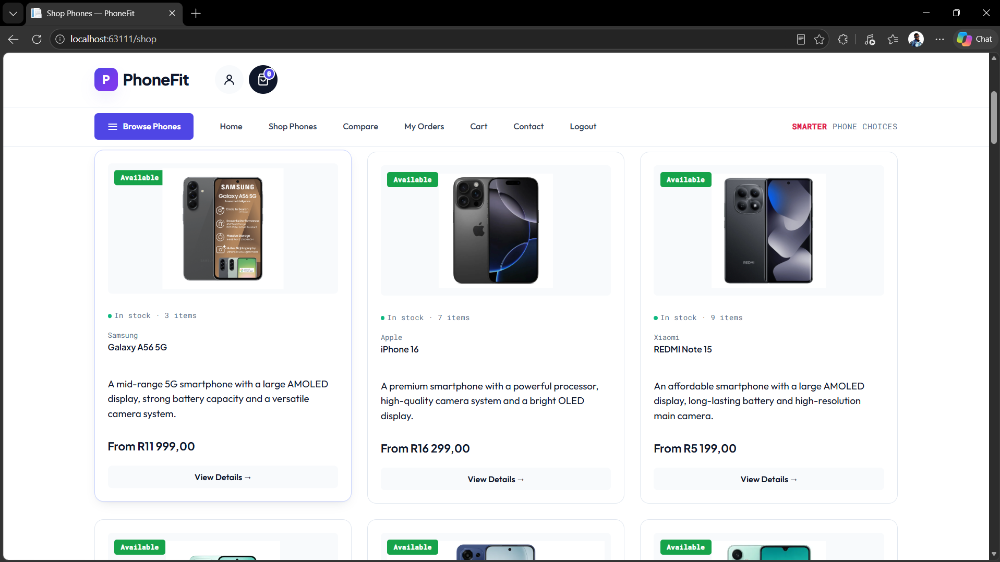
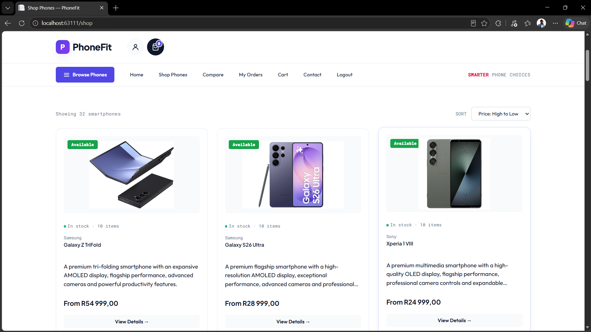
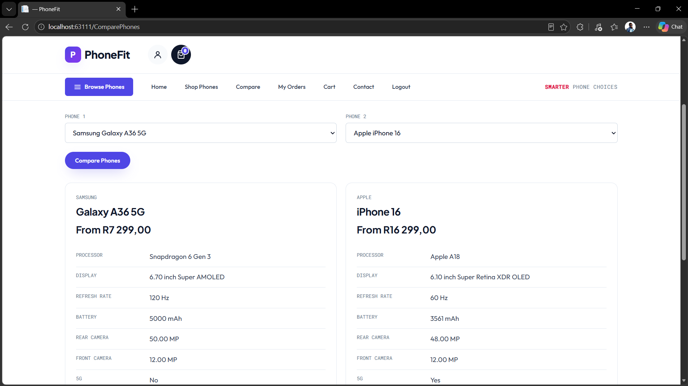
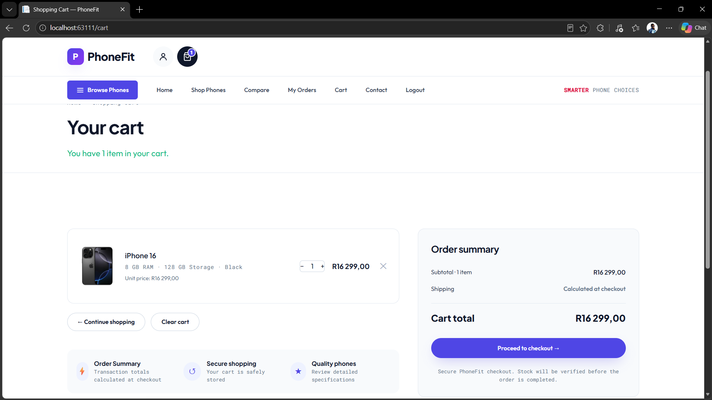
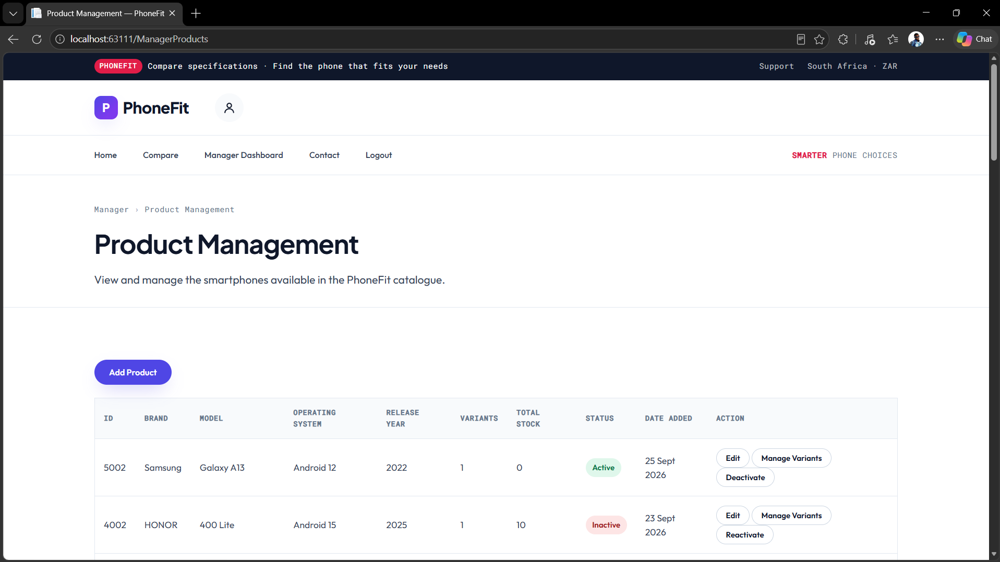

# PhoneFit

PhoneFit is a database-driven smartphone e-commerce platform developed as a team academic project at the University of Johannesburg. The platform helps customers browse, compare and select smartphones based on their budget, intended use and preferences.

The completed project received a final result of **89%**.

## Video Demonstration

A demonstration of the completed PhoneFit application is available on YouTube:

https://youtu.be/9OFl9n2Po6M

## Features

- Customer registration and authentication
- Smartphone product catalogue
- Product searching and filtering
- Side-by-side smartphone comparison
- Personalised smartphone recommendations
- Authenticated shopping cart
- Manager product-management functionality
- Database-driven product and customer information
- Role-based functionality for customers and managers

## Technologies Used

- C#
- ASP.NET Web Forms
- .NET Framework 4.7.2
- SQL Server LocalDB
- Windows Communication Foundation (WCF)
- HTML
- CSS
- JavaScript
- Visual Studio
- Git and GitHub

## Project Structure

```text
PhoneFit-Portfolio/
|-- Database/          # Database creation scripts, sample data and instructions
|-- PhoneFit/          # Customer-facing ASP.NET web application
|-- PhoneFitService/   # WCF backend service and database operations
`-- Sprylo-1.0.0/      # Front-end template assets used by the application
```

## Database Setup

1. Open SQL Server Management Studio or Visual Studio's SQL Server Object Explorer.
2. Run `Database/CreateTables.txt` to create the `PhoneFitDB` database and its tables.
3. Run `Database/InsertData.txt` to add the required sample data.
4. Confirm that SQL Server LocalDB is installed.
5. Verify that the connection string in `PhoneFitService/Web.config` uses:

```text
Data Source=(localdb)\MSSQLLocalDB;
Initial Catalog=PhoneFitDB;
Integrated Security=True;
```

## Running the Application

1. Clone or download this repository.
2. Open the solution in Visual Studio.
3. Restore any required NuGet packages.
4. Ensure the `PhoneFitDB` database has been created.
5. Start the `PhoneFitService` project.
6. Confirm that the service endpoint matches the endpoint configured in the PhoneFit web application's `Web.config`.
7. Run the `PhoneFit` web application.

The local service port may need to be updated if Visual Studio assigns a different port.

## My Contributions

My contributions to the project included:

- Implementing authenticated shopping-cart functionality
- Developing and improving the user interface
- Implementing manager product-management functionality
- Supporting database integration
- Assisting with the integration and testing of application features

## Academic Project Acknowledgement

PhoneFit was originally developed as a team academic project at the University of Johannesburg. This repository contains a portfolio copy of the completed application.

The repository is intended to demonstrate the technical skills and contributions of the repository owner. Credit for the complete system belongs to the original project team.

## Project Status

The academic project was completed in September 2026 and received a final result of **89%**.

## Screenshots

### Product Catalogue



### Smartphone Filtering



### Phone Comparison



### Shopping Cart



### Manager Product Management


